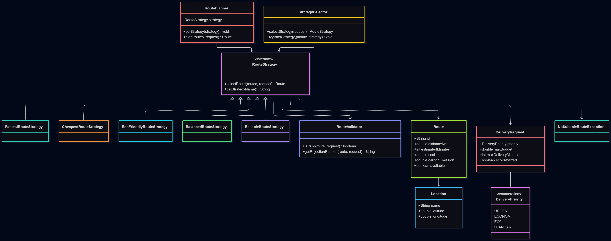
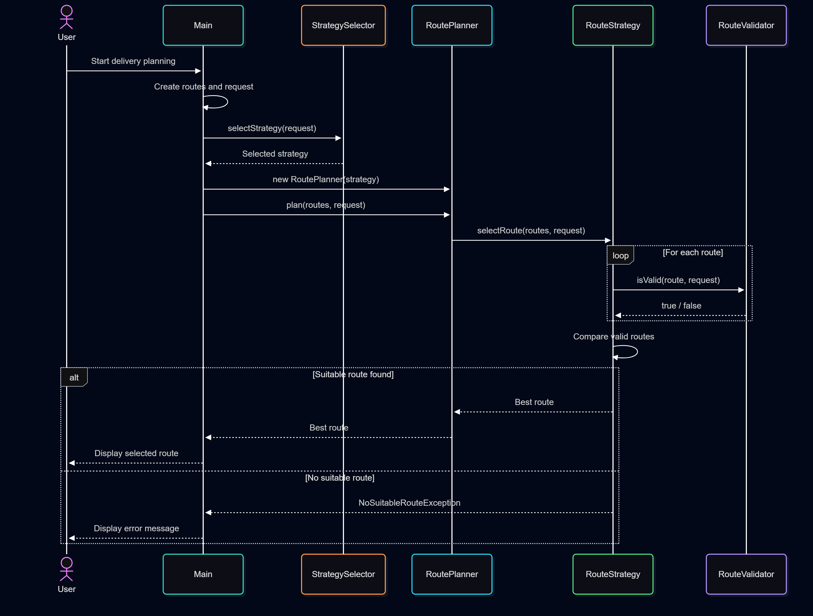

# Smart Delivery & Route Optimization Engine

## 1. Project Overview

This project is a Java application that selects the best delivery route based on different customer requirements.

The system uses the **Strategy Design Pattern** to support different route selection algorithms. Users can choose a delivery priority, and the application automatically selects a suitable strategy.

The project was developed using Java, Maven, JUnit 5 and IntelliJ IDEA.

## 2. Design Pattern

**Strategy Pattern**

The Strategy Pattern allows the application to use different algorithms without changing the main route planning class.

The `RouteStrategy` interface defines two methods:

- `selectRoute()` — selects the best route.
- `getStrategyName()` — returns the strategy name.

The `RoutePlanner` class uses this interface and supports changing strategies at runtime through `setStrategy()`.

## 3. Implemented Strategies

| Strategy | Description |
|---|---|
| FastestRouteStrategy | Selects the route with the shortest delivery time |
| CheapestRouteStrategy | Selects the route with the lowest total delivery cost |
| EcoFriendlyRouteStrategy | Selects the route with the lowest environmental score |
| BalancedRouteStrategy | Selects a route using weighted time, cost, distance and carbon emissions |
| ReliableRouteStrategy | Selects a route using a risk score based on time and distance |

### Cost Calculation

The Cheapest Strategy uses the following formula:

`Total Cost = Base Cost + Distance × 50 + Urgent Fee`

The urgent fee is 500 when the delivery priority is URGENT.

### Eco Score

`Eco Score = Carbon Emission × 0.7 + Distance × 0.3`

### Balanced Score

`Balanced Score = 0.4 × Normalized Time + 0.3 × Normalized Cost + 0.1 × Normalized Distance + 0.2 × Normalized Carbon Emission`

### Reliability Score

`Risk Score = Estimated Minutes × 0.6 + Distance × 0.4`

This score is a simplified estimate based on time and distance, not a prediction of real-world delivery reliability.

## 4. Main Classes

- `Route` — stores route information.
- `Location` — stores location information.
- `DeliveryRequest` — stores customer requirements.
- `DeliveryPriority` — defines delivery priorities.
- `RouteStrategy` — common interface for all strategies.
- `RoutePlanner` — executes the selected strategy.
- `StrategySelector` — automatically chooses a strategy based on priority.
- `RouteValidator` — validates routes and delivery constraints.
- `NoSuitableRouteException` — handles cases when no suitable route exists.
- `Main` — demonstrates the application.

## 5. Route Validation

Before selecting a route, the application checks:

1. Whether the route is available.
2. Whether route data is valid.
3. Whether the route meets the delivery budget.
4. Whether the route meets the maximum delivery time.

Invalid routes are rejected.

## 6. Automatic Strategy Selection

| Delivery Priority | Selected Strategy |
|---|---|
| URGENT | FastestRouteStrategy |
| ECONOMY | CheapestRouteStrategy |
| ECO | EcoFriendlyRouteStrategy |
| STANDARD | BalancedRouteStrategy |

The application also supports registering another strategy through `StrategySelector`.

## 7. Comparison Mode

The application includes a comparison mode that runs all five strategies on the same delivery request.

This makes it possible to compare route selection results and understand how different algorithms make decisions.

## 8. Testing

A total of 29 JUnit 5 tests passed successfully.

Test result:
29 tests, 0 failures, 0 errors.

The tests include boundary testing, strategy switching,
route validation, budget restrictions, deadline restrictions
and exception handling.

Tests cover:

- Route selection algorithms.
- Unavailable routes.
- Budget and deadline constraints.
- Invalid strategy weights.
- Automatic strategy selection.
- Runtime strategy switching.
- Route validation.
- Exception handling.

**Test result:** 28 tests, 0 failures, 0 errors.

## 9. UML Diagrams

### Class Diagram



### Sequence Diagram



The Class Diagram shows the structure of the system.

The Sequence Diagram shows the route selection process and interactions between objects.

## 10. How to Run

1. Clone the repository from GitHub.
2. Open the project in IntelliJ IDEA.
3. Load the Maven project.
4. Open `Main.java`.
5. Run the `main()` method.
6. Check the selected route, validation report and strategy comparison.

To run automated tests, open the Maven tool window and select **Lifecycle → test**.

## 11. SOLID Principles

**Single Responsibility Principle (SRP):** Each strategy is responsible for its own route selection algorithm. `RouteValidator` handles route validation.

**Open/Closed Principle (OCP):** New strategies can be added by implementing `RouteStrategy` without changing `RoutePlanner`.

**Liskov Substitution Principle (LSP):** Concrete strategies can be used wherever `RouteStrategy` is expected.

**Interface Segregation Principle (ISP):** `RouteStrategy` contains only the methods needed for route selection.

**Dependency Inversion Principle (DIP):** `RoutePlanner` depends on the `RouteStrategy` interface instead of concrete strategy classes.

## 12. Technologies

- Java 25
- Maven
- JUnit 5
- IntelliJ IDEA
- Git and GitHub
- UML

## 13. Conclusion

This project demonstrates how the Strategy Design Pattern can be used to build a flexible delivery route optimization system.

The application supports five route selection strategies, automatic strategy selection, route validation, runtime strategy switching, comparison mode and automated testing.

The Strategy Pattern makes the system easier to extend, test and maintain.

## 14. Assignment Questions and Answers

**1. What problem does Strategy solve in this project?**

The Strategy Pattern helps us use different route selection algorithms without writing many if/else conditions in RoutePlanner.

**2. Where is the Context?**

RoutePlanner is the Context. It stores a RouteStrategy object and calls its selectRoute() method.

**3. Where is the Strategy interface?**

RouteStrategy is the Strategy interface. It defines the common methods for all route selection algorithms.

**4. What are the Concrete Strategies?**

The Concrete Strategies are FastestRouteStrategy, CheapestRouteStrategy, EcoFriendlyRouteStrategy, BalancedRouteStrategy and ReliableRouteStrategy.

**5. Where is runtime strategy switching demonstrated?**

Runtime switching is supported by the setStrategy() method in RoutePlanner. It allows the same planner object to use another algorithm.

**6. Why is this Strategy rather than simple if/else?**

Each algorithm is implemented in a separate class. This makes the code easier to maintain, test and extend.

**7. How can a new Strategy be added?**

We create a new class that implements RouteStrategy. Then we can use it in RoutePlanner or register it in StrategySelector without changing the RoutePlanner algorithm.

**8. What is the difference between Strategy and Bridge?**

Strategy focuses on changing algorithms or behaviors. Bridge separates an abstraction from its implementation so both can develop independently. In our previous notification assignment, Bridge separated notification types from message senders.

**9. Which SOLID principles are demonstrated?**

The project demonstrates SRP, OCP and DIP. Different classes have separate responsibilities, new strategies can be added, and RoutePlanner depends on the RouteStrategy interface.

**10. What limitation does your current architecture have?**

The application uses predefined routes and simplified calculations. It does not use real-time traffic, weather or GPS information. Also, strategy explanations are printed directly to the console instead of being returned as structured data.

## 15. Example Console Output

The following is a shortened example of the expected output for the demonstration routes.

```text
=== RUNTIME STRATEGY SWITCHING ===

1. Fastest Strategy:
Selected: R5

2. Cheapest Strategy:
Selected: R6

3. Eco-Friendly Strategy:
Selected: R5

4. Balanced Strategy:
Selected: R5
```

The application also prints explanations showing why each strategy selected a route and why other routes were rejected.

The same RoutePlanner object is used for all four strategies. The algorithm is changed three times using setStrategy().

## 16. Final Testing Summary

- Total JUnit 5 tests: 29
- Failed tests: 0
- Errors: 0
- Five route selection strategies implemented
- Three runtime strategy switches demonstrated
- Two UML diagrams included
- Strategy Pattern and SOLID principles explained